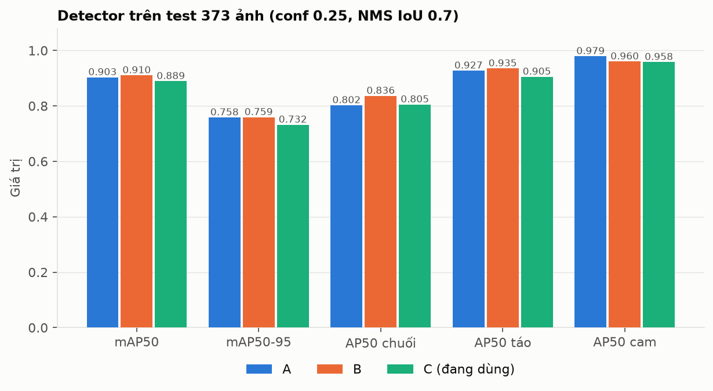
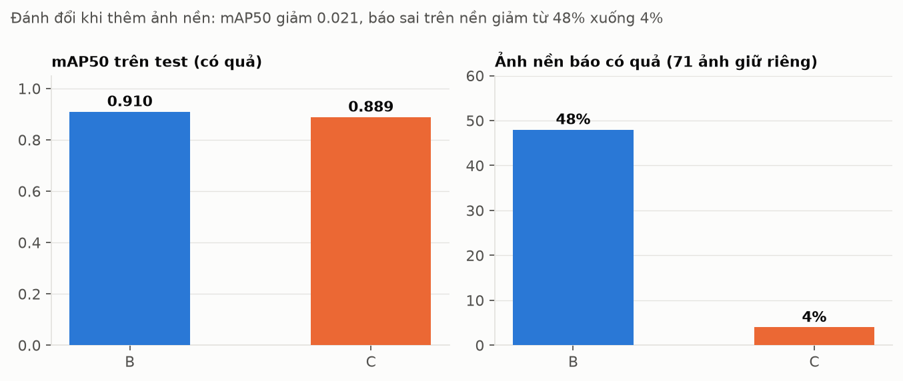
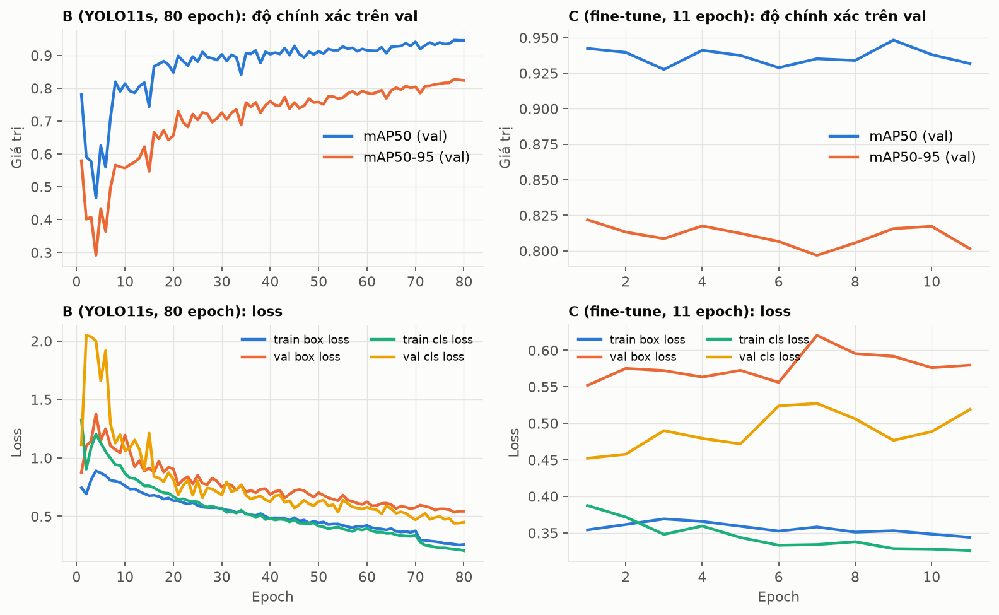
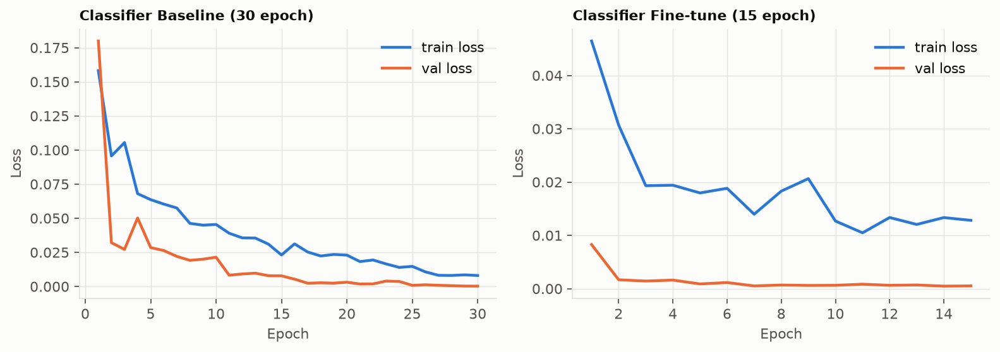
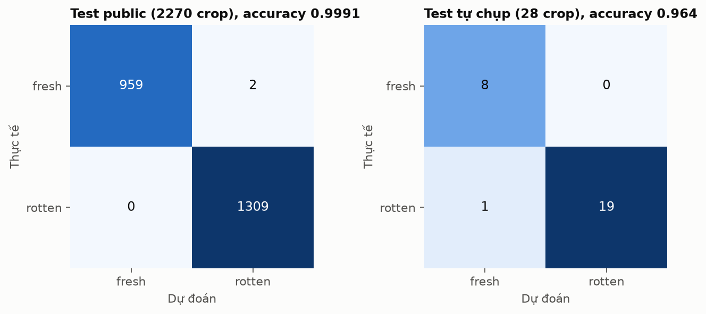
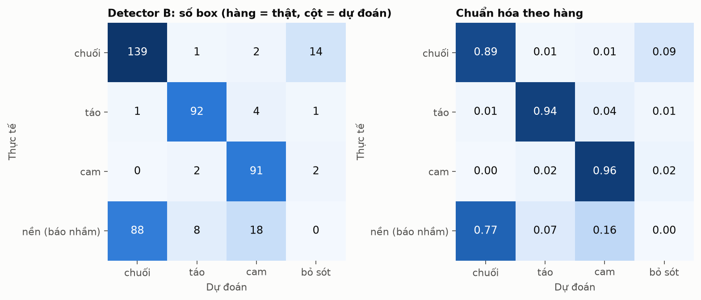
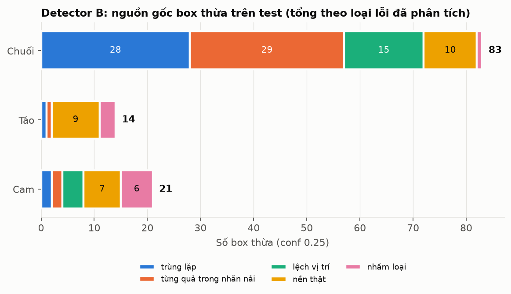
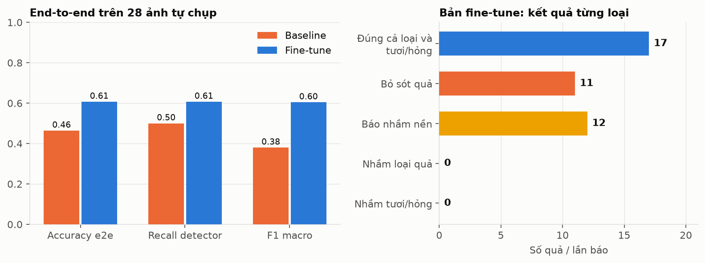
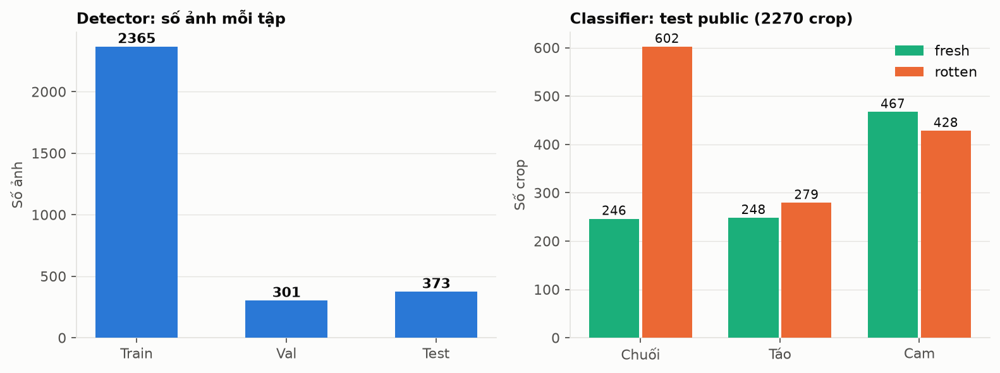

# Nhận dạng trái cây và đánh giá độ tươi bằng YOLO11

Báo cáo đồ án môn Xử lý ảnh. Hệ thống tìm từng quả **chuối, táo, cam** trong ảnh rồi cho biết quả **tươi** hay **hỏng**. README này tập trung vào **quy trình huấn luyện** (mục 3-4) và **kết quả** (mục 5). Cách chạy hệ thống ở mục 7.

## 1. Bài toán và kiến trúc

Hai tầng YOLO11 nối tiếp:

```
Ảnh ─► Detector YOLO11 (640×640) ─► box: banana | apple | orange
         conf ≥ 0.40, NMS IoU 0.6
                      ▼
          cắt từng box (đệm 10%) ─► Classifier YOLO11n-cls (224×224) ─► fresh | rotten
```

- **Detector**: 3 lớp (banana, apple, orange), cho biết vị trí và loại quả.
- **Classifier**: 2 lớp (fresh, rotten), huấn luyện riêng trên ảnh quả đã cắt.
- Tách hai tầng để mỗi model học một việc, dễ đo và cải thiện riêng. Kết quả cuối cho mỗi quả gồm 6 trạng thái (`banana_fresh` ... `orange_rotten`).

Web demo: FastAPI (backend) + React/Ant Design (frontend), nhận ảnh, video, webcam.

### 1.1 Hai bài toán và đầu vào/đầu ra

| Thành phần | Bài toán | Đầu vào | Đầu ra |
|---|---|---|---|
| YOLO11 Detector | Object Detection | Ảnh gốc, resize 640×640 | Bounding box + loại quả + confidence |
| Crop | Tiền xử lý | Ảnh gốc + 1 box (mở rộng 10% mỗi cạnh) | Ảnh riêng của từng quả |
| YOLO11n-cls | Image Classification | Crop, resize 224×224 | fresh / rotten + confidence |

- **Detection** trả lời "có gì và ở đâu" (nhiều đối tượng, có tọa độ). **Classification** trả lời "ảnh này thuộc lớp nào" (một nhãn cho cả ảnh, không có vị trí).
- **Vì sao crop**: classifier chỉ nhìn đúng một quả nên không bị nền và quả bên cạnh làm nhiễu, và cùng một ảnh có thể có quả tươi lẫn quả hỏng, nên phải phân loại từng quả chứ không phải cả ảnh. **Padding 10%** để không cắt mất rìa quả và giữ một ít ngữ cảnh (box dự đoán thường hơi chặt hoặc lệch); giá trị 10% là chọn thực nghiệm, chưa khảo sát các mức khác.
- **Vì sao không dùng một detector 6 lớp** (`banana_fresh`, `banana_rotten`, ...): làm được, nhưng hai tầng cho phép detector chỉ học hình dạng và vị trí, còn classifier tập trung vào màu bề mặt, đốm thâm, nhăn vỏ; mỗi tầng có dữ liệu và chỉ số riêng nên cải tiến độc lập (ví dụ chỉ thêm ảnh nền cho detector mà không động đến classifier). Classifier hiện có tới 10088 ảnh crop huấn luyện, nhiều hơn số ảnh detector có nhãn, và nhãn tươi/hỏng chủ yếu lấy từ các bộ dữ liệu phân loại có sẵn. Nhược điểm: sai số của detector (bỏ sót, box lệch, nhận nhầm nền) truyền sang classifier, và cần hai lần suy luận. Mình **chưa train thử** phương án 6 lớp nên không khẳng định hai tầng cho độ chính xác cao hơn.
- **Vì sao YOLO thay vì CNN/ResNet đơn thuần**: ResNet cho ra một nhãn cho cả ảnh, không định vị được nhiều quả. So với Faster R-CNN (hai giai đoạn, thường chính xác nhưng chậm hơn) và SSD, YOLO là bộ phát hiện một giai đoạn, nhanh, phù hợp webcam/video và GPU 6GB. Đây là lý do thiết kế, **chưa được đo so sánh trực tiếp** trong đồ án.

## 2. Dữ liệu

| Tập | Số lượng |
|---|---|
| Detector: train / val / test | 2365 / 301 / 373 ảnh |
| Classifier (fine-tune): train / val | 3191 / 2310 ảnh crop |
| Classifier: test public / test ảnh tự chụp | 2270 / 28 ảnh |
| Ảnh nền không có quả (`own_neg`, Wikimedia Commons): train / giữ riêng để đo | 287 / 71 ảnh |

Nguồn: bộ dữ liệu công khai (Roboflow, Kaggle) gộp và ánh xạ nhãn qua `configs/remap_*.yaml`, thêm ảnh tự thu thập. Không có rò rỉ nguồn giữa train/val/test; ảnh gần giống (dHash) khoảng 1%.

Ba vấn đề dữ liệu phát hiện khi đánh giá, và là lý do phải huấn luyện nhiều vòng:

1. **Nhãn chuối không thống nhất** (nải hay từng quả): phần lớn box chuối thừa là do nhãn lẫn lộn (42 box từng quả nằm trong nhãn nải, 27 trùng lặp, 23 lệch). Chốt quy ước gán từng quả; 50 ảnh train nghi nhãn sai bị loại (không xóa file).
2. **Nhận nhầm vật khác thành quả**: trên 358 ảnh nền sạch, model ban đầu báo có quả ở khoảng 42% ảnh (ớt chuông, bóng, cốc, mặt người, bàn tay, mặt bàn). Tập test gốc không có ảnh nền nên không phản ánh lỗi này.
3. **Thiếu cảnh nhiều loại quả chung khung**: chỉ 21/2365 ảnh train có từ 2 loại quả trở lên.

### 2.1 Vai trò từng tập và vì sao hai model dùng hai bộ dữ liệu

- **Train** cập nhật trọng số; **Validation** theo dõi quá trình train, chọn checkpoint và dừng sớm; **Test** chỉ để đánh giá cuối, không dùng để huấn luyện.
- Detector cần ảnh **nguyên cảnh có box**; classifier cần **ảnh crop từng quả có nhãn tươi/hỏng**, và các bộ dữ liệu phân loại công khai (Kaggle, Roboflow) có số lượng lớn hơn nhiều so với bộ có box. Vì vậy hai model dùng hai bộ dữ liệu riêng, rồi gộp thêm ảnh tự thu cho cả hai.
- Nhãn tươi/hỏng của classifier lấy theo **tên thư mục của bộ dữ liệu gốc** (`fresh*` / `rotten*`, ánh xạ trong `configs/remap_cls_*.yaml`); nguồn gồm Kaggle `sriramr/fruits-fresh-and-rotten-for-classification` và bộ Roboflow `rf_v3i`. **Đồ án không tự đặt tiêu chí chi tiết cho "hỏng"** (thối, mốc, thâm, phân hủy); tiêu chí phụ thuộc người gán nhãn của bộ gốc. Ảnh tự thu (táo xanh thối, chuối phân hủy, video timelapse) được gán nhãn theo nguồn, chưa có văn bản tiêu chí riêng. Đây là một hạn chế cần nêu khi bảo vệ.
- Quả chín nhưng chưa hỏng có thể giống quả hỏng về màu (nâu, đốm), nên không thể chỉ dựa vào màu để kết luận tươi/hỏng; classifier học thêm kết cấu, hình dạng và vùng thâm.

### 2.2 Chia tập và phòng rò rỉ dữ liệu (Data Leakage)

Mô tả theo mã trong `fruit_yolo_colab.ipynb` (kết quả kiểm tra lưu ở `work/split_report.csv`, `work/split_images.csv`, `work/split_cls.csv`):

1. Ảnh công khai được **gom nhóm** trước khi chia: cùng ảnh gốc Roboflow (`<tên>_jpg.rf.<mã>`, tức cùng ảnh nhưng khác augmentation) hoặc có dHash 64-bit gần nhau (ngưỡng 6 bit, tính cả bản lật ngang) thì vào cùng nhóm; cả nhóm chỉ nằm ở **một** tập.
2. Ảnh tự thu chia theo **nguồn video**, để các khung hình liền nhau không nằm ở hai tập.
3. Có lệnh `assert` dừng chương trình nếu một nhóm hoặc một nguồn video xuất hiện ở hai tập; ảnh công khai giữ nguyên tập khi thêm ảnh tự thu.
4. Việc chia theo nhóm cũng quyết định tập crop của classifier, nên crop từ ảnh test của detector không lọt vào train của classifier.
5. Kiểm tra bổ sung: không có rò rỉ nguồn Roboflow giữa train/val/test; ảnh val/test gần giống ảnh train (dHash) khoảng 1% (`work/audit_det_labels.py`). Ảnh nền giữ riêng cũng chia theo khối để tránh rò rỉ.

Giới hạn: kết quả các `assert` không được lưu thành log riêng, chỉ lưu kết quả chia; bộ dữ liệu công khai của classifier có thể vẫn chứa ảnh tương tự về nội dung (cùng kiểu chụp, cùng nền) dù khác tệp, nên accuracy 99.91% trên test public **không nên hiểu là độ chính xác ngoài thực tế**.

### 2.3 Số mẫu

- Detector (tổng số box): chuối 1037, táo 680, cam 660. Chuối nhiều nhất nhưng nhãn kém nhất vì nải/từng quả.
- Classifier test public (2270 crop): fresh 961, rotten 1309 (hơi lệch về rotten); chuối 848 (246/602), táo 527 (248/279), cam 895 (467/428) theo thứ tự fresh/rotten.
- Classifier test tự chụp (28 ảnh): fresh 8, rotten 20; chuối 12 (8 fresh, 4 rotten), táo 7 (0 fresh, 7 rotten), cam 9 (0 fresh, 9 rotten). **Không có mẫu táo tươi và cam tươi.**
- Dữ liệu mất cân bằng nhẹ ở classifier (nguồn `sriramr` train có 1952 fresh và 3580 rotten); không áp dụng trọng số lớp riêng, chỉ dựa vào augmentation và dữ liệu thêm.

## 3. Quy trình huấn luyện detector

Phần cứng: RTX 3060 Laptop 6GB. Ultralytics 8.4.180, PyTorch 2.5.1+cu121. Chung cho mọi lần train: ảnh 640, batch 16, optimizer SGD, seed 42, augmentation mặc định của Ultralytics (mosaic 1.0, lật ngang 0.5, HSV 0.015/0.7/0.4), AMP bật.

| Bản | Cách huấn luyện | Epoch | lr0 |
|---|---|---|---|
| **A** (baseline) | YOLO11n pretrained COCO; sau đó fine-tune từ bản tốt nhất với tập có thêm ảnh tự thu | 50, rồi fine-tune 21 (dừng sớm, tối đa 30) | 0.01, rồi 0.002 |
| **B** (làm sạch nhãn) | YOLO11s pretrained COCO, train lại trên tập đã loại 50 ảnh nghi nhãn sai và gán lại nhãn chuối từng quả | 80 (~37 phút) | 0.01 |
| **C** (thêm ảnh nền, **đang dùng**) | Fine-tune từ B, thêm 287 ảnh nền (nhãn rỗng) lặp 2 lần, bỏ ảnh webcam tự gán nhãn | 25 tối đa, dùng `last.pt` ở epoch 11 | 0.002 |
| D1 (thử nghiệm) | Fine-tune từ C, thêm 700 ảnh ghép nhiều loại quả | 20 tối đa | 0.002 |

Các quyết định đáng chú ý:

- **Ảnh nền** được chia theo khối (ảnh lẻ chia theo hash tên, video chia theo 20 khung liên tiếp) để 71 ảnh giữ riêng không bị rò rỉ sang train.
- **Dùng `last.pt` thay vì `best.pt` cho C**: tập val không có ảnh nền nên `best.pt` rơi vào epoch 1 (chưa học phân biệt nền). Số liệu train/val lúc huấn luyện vì vậy chỉ để theo dõi; các so sánh chính đều đo trên **test 373 ảnh** và **71 ảnh nền giữ riêng**.
- **Cùng điều kiện so sánh**: cùng val/test, seed 42, conf 0.25, NMS IoU 0.7 (`work/eval_det.py`, kết quả ở `work/audit/eval_*.json`).
- Thí nghiệm D1 mới chạy được 4/20 epoch và chưa được đánh giá trên test, nên **chưa đưa vào kết quả**.

## 4. Quy trình huấn luyện classifier

| Lần | Dữ liệu | Model khởi tạo | Epoch | Optimizer, lr0 | Thời gian |
|---|---|---|---|---|---|
| Baseline | `cls/base`: 10088 train, 2270 val | YOLO11n-cls pretrained | 30 | AdamW, 0.001 | ~4.6 phút |
| Fine-tune (**đang dùng**) | `cls/ft`: 3191 train, 2310 val (có thêm ảnh tự chụp) | baseline `best.pt` | 15 | AdamW, 0.0002 | ~0.9 phút |

Batch 64, ảnh 224×224, seed 42. Cả hai lần đạt accuracy val 1.0, nên val không còn phân biệt được hai model; việc chọn dựa vào test public và test ảnh tự chụp (bảng 5.3).

## 5. Kết quả

### 5.1 Detector (test 373 ảnh, conf 0.25, NMS IoU 0.7)

| | A | B | C (đang dùng) |
|---|---|---|---|
| mAP50 | 0.903 | 0.910 | 0.889 |
| mAP50-95 | 0.758 | 0.759 | 0.732 |
| AP50 chuối | 0.802 | 0.836 | 0.805 |
| AP50 táo | 0.927 | 0.935 | 0.905 |
| AP50 cam | 0.979 | 0.960 | 0.958 |
| Ảnh nền báo sai (trên 71 ảnh giữ riêng) | - | 34 (48%) | 3 (4%) |

- B cải thiện nhẹ so với A (mAP50 +0.007, chuối +0.034) nhờ làm sạch nhãn và dùng YOLO11s, nhưng vẫn báo sai 48% ảnh nền.
- C giảm báo sai trên ảnh nền từ 48% xuống 4%, **đổi lại** mAP50 giảm 0.021 và AP chuối giảm 0.031. Đây là đánh đổi có chủ đích vì nhận nhầm vật khác thành quả là lỗi dễ thấy nhất khi dùng webcam.
- Tốc độ B (FP16, GPU): trung vị 16.5 ms/ảnh, VRAM đỉnh 114 MB.

Phân tích lỗi của B ở conf 0.25: chuối có 89 box thừa, trong đó chỉ 10 là nền thật; 29 là box từng quả nằm trong nhãn nải, 28 là box trùng lặp, 15 lệch vị trí. Tức là phần lớn "lỗi" chuối đến từ nhãn không thống nhất chứ không phải model nhận sai (`work/audit/eval_B_clean.json`).

### 5.2 Chọn ngưỡng tin cậy (model C, quét 0.15-0.60)

Chốt **conf = 0.40**: F1 tổng 0.82 (Precision 0.80, Recall 0.84); F1 chuối 0.73, táo 0.89, cam 0.90. Ở ngưỡng này ảnh nền báo sai còn 1/71.

### 5.3 Classifier

| | Test public (2270 crop) | Test ảnh tự chụp (28 crop) |
|---|---|---|
| Accuracy | 0.9991 | 0.964 (27/28) |
| F1 macro | 0.9991 | 0.958 |
| Recall / Precision của lớp rotten | 1.000 / 0.998 | 0.95 / 1.00 |

Baseline và fine-tune ngang nhau trên test public (accuracy cùng 0.9991), nên dùng bản fine-tune vì có thêm ảnh tự chụp. Tốc độ ~10.7 ms/crop.

Ảnh tự chụp chỉ có 28 ảnh (táo và cam không có mẫu fresh; chuối 12 ảnh, táo 7, cam 9), nên con số 27/28 chỉ mang tính tham khảo. Sai duy nhất là một quả táo hỏng bị đoán thành tươi.

### 5.4 Đánh giá toàn pipeline (end-to-end)

Đo trên ảnh gốc: detector dự đoán box (không dùng box ground truth để crop) rồi classifier phân loại, so với nhãn 6 lớp. Tập duy nhất đo được là **test tự chụp, 28 ảnh / 28 quả** (`runs/e2e_*/metrics/e2e_summary.json`):

| | Baseline | Fine-tune |
|---|---|---|
| Accuracy end-to-end (đúng cả loại quả lẫn tươi/hỏng) | 0.464 | **0.607** (17/28) |
| Recall detector | 0.500 | 0.607 |
| Accuracy tươi/hỏng khi đã nhận đúng loại quả | 1.0 | 1.0 |
| F1 macro | 0.380 | 0.604 |
| Sai số đếm số quả (MAE) / đếm đúng hoàn toàn | 0.393 / 21% | 0.179 / 50% |
| Thời gian | 32 ms/ảnh | 46 ms/ảnh |

Bản fine-tune: nhầm loại quả 0, nhầm tươi/hỏng 0, **bỏ sót 11 quả** (5 là `apple_rotten`), **báo nhầm nền 12 lần**. Theo lớp (P/R/F1): `banana_fresh` 0.62/1.0/0.76, `banana_rotten` 0.8/1.0/0.89, `apple_rotten` 0.5/0.29/0.36, `orange_rotten` 0.5/0.33/0.40.

Cách đọc: **điểm yếu của hệ thống nằm ở tầng detector, không phải classifier.** Khi detector tìm đúng quả thì classifier đúng 100% trên 28 ảnh này, nhưng detector bỏ sót khoảng 40% quả và báo nhầm nền. Hai điều cần lưu ý khi trình bày:

- Đây là phép đo trên **28 ảnh**, rất nhỏ, kết quả dao động mạnh; ảnh tự chụp khó hơn ảnh công khai (táo/cam hỏng chụp thực tế, nền lộn xộn).
- Phép đo end-to-end này **chưa được chạy lại với detector C và ngưỡng 0.40** (C chủ yếu làm giảm báo nhầm nền, nên số báo nhầm nền 12 có thể đã cải thiện nhưng chưa được đo). Cần đo lại trước khi kết luận về bản đang dùng.
- Con số classifier 99.91% là trên crop của tập công khai; số end-to-end 60.7% là trên ảnh gốc tự chụp qua cả hai tầng. Hai con số trả lời hai câu hỏi khác nhau, không thể so trực tiếp.

### 5.5 Biểu đồ

Các hình dưới đây do `python work/make_figures.py` vẽ từ số liệu trong `runs/` và `work/audit/` (lưu ở `docs/figures/`).

**Hình 1. So sánh detector A, B, C trên test.** Trục bắt đầu từ 0 nên chênh lệch giữa ba bản nhỏ (dưới 0.03 ở hầu hết chỉ số).



**Hình 2. Đánh đổi khi thêm ảnh nền (B sang C).** mAP50 chỉ giảm 0.021 trong khi tỷ lệ ảnh nền báo sai giảm từ 48% xuống 4%.



**Hình 3. Đường huấn luyện detector.** B hội tụ dần trong 80 epoch, loss train và val cùng giảm, không thấy dấu hiệu overfitting rõ rệt. C chỉ fine-tune 11 epoch nên các đường gần như phẳng; mAP trên val dao động nhẹ vì val không có ảnh nền (lý do chọn `last.pt`, mục 8.1).



**Hình 4. Đường huấn luyện classifier.** Loss rất thấp từ sớm, khớp với accuracy val 1.0: tập val quá dễ để phân biệt các bản.



**Hình 5. Confusion matrix classifier.** Test public sai 2/2270 (táo tươi đoán thành hỏng); test tự chụp sai 1/28 (táo xanh thối đoán thành tươi).



**Hình 6. Confusion matrix detector B (conf 0.25).** Hàng cuối là box báo nhưng không khớp quả thật nào (gồm cả nền thật, box trùng và box từng quả trong nhãn nải); cột cuối là quả bị bỏ sót. Chuối chiếm 88 trong số 114 box báo sai.



**Hình 7. Nguồn gốc box thừa của B.** Với chuối, phần lớn box thừa là box trùng lặp và box từng quả nằm trong nhãn nải, chỉ 10 box là nền thật. Tổng theo loại lỗi đã phân tích (83, 14, 21) hơi khác số FP trong bảng precision (89, 11, 24) vì hai phép đếm phân loại riêng một số box.



**Hình 8. Đánh giá end-to-end trên 28 ảnh tự chụp.** Điểm yếu nằm ở detector (bỏ sót 11, báo nhầm nền 12); khi tìm đúng quả thì không nhầm loại quả hay tươi/hỏng nào.



**Hình 9. Quy mô dữ liệu.** Bên phải là test public của classifier theo loại quả và trạng thái.



### 5.6 Hình có sẵn từ Ultralytics trong repo

| Nội dung | Tệp |
|---|---|
| Đường train/val loss, mAP theo epoch | `runs/det_baseline/results.png`, `runs/exp/det_C_neg/results.csv`, `runs/cls_finetune/results.png` |
| Confusion matrix detector | `runs/det_finetune/metrics/confusion_matrix_test*.png` |
| Confusion matrix classifier | `runs/cls_finetune/metrics/cls_confusion_test_{public,own}.png` |
| Đường PR/F1/P/R của detector | `runs/det_baseline/BoxPR_curve.png`, `BoxF1_curve.png` |
| Confusion matrix và so sánh end-to-end | `runs/e2e_finetune/metrics/e2e_confusion.png`, `compare_e2e.png` |
| Ảnh classifier dự đoán sai | `runs/cls_finetune/metrics/cls_errors_test_{public,own}/` |
| Box thừa của detector kèm loại lỗi | `work/audit/fp_A_baseline.csv`, `fp_B_clean.csv` |

Confusion matrix classifier (hàng = thật, cột = dự đoán, thứ tự fresh, rotten): test public `[[959, 2], [0, 1309]]` (2 ảnh sai đều là táo tươi bị đoán thành hỏng); test tự chụp `[[8, 0], [1, 19]]` (1 ảnh sai là táo xanh đang thối bị đoán thành tươi).

Các đường train/val của det_C_neg chỉ có 11 epoch, và det_finetune dừng sớm ở epoch 21 (tối đa 30), nên các đường này chỉ phản ánh giai đoạn fine-tune.

### 5.7 Bảng tổng hợp chỉ số đánh giá

**Detector** (test 373 ảnh, trừ khi ghi khác)

| Chỉ số | Kết quả | Ghi chú |
|---|---|---|
| IoU | Ngưỡng 0.5 (AP50) và 0.5-0.95 (mAP50-95); NMS IoU 0.6 khi chạy hệ thống | Định nghĩa ở mục 7 |
| Precision / Recall (conf 0.25) | A: 0.848 / 0.879; B: 0.879 / 0.866; C: chưa lưu | B theo lớp: chuối 0.61/0.89, táo 0.89/0.94, cam 0.79/0.96 (precision/recall) |
| Precision / Recall / F1 (conf 0.40) | C: 0.80 / 0.84 / **0.82** | F1 theo lớp: chuối 0.73, táo 0.89, cam 0.90 |
| AP50 | Hình 1 (A, B, C theo từng loại quả) | |
| mAP50 / mAP50-95 | A 0.903 / 0.758; B 0.910 / 0.759; C 0.889 / 0.732 | |
| FPR trên ảnh nền (số ảnh nền có ít nhất một box, trên 71 ảnh giữ riêng) | B 34/71 = 47.9%; C 3/71 = 4.2% (conf 0.25); C 1/71 = 1.4% (conf 0.40) | Đây là tỷ lệ theo ảnh, không phải theo box |
| Độ trễ detector (FP16, GPU) | Trung vị 16.5 ms/ảnh (bản B) | Chưa đo riêng cho bản C |

**Classifier**

| Chỉ số | Test public (2270) | Test tự chụp (28) |
|---|---|---|
| Accuracy | 0.9991 | 0.964 |
| Precision / Recall lớp rotten | 0.998 / 1.000 | 1.00 / 0.95 |
| F1 macro | 0.9991 | 0.958 |
| Confusion matrix | Hình 5 | Hình 5 |
| Độ trễ | ~10.7 ms/crop | |

ROC-AUC **không được tính**: đây là chỉ số tùy chọn, cần xác suất từng mẫu để quét ngưỡng; đồ án chưa làm, và với accuracy gần 1.0 trên test public thì AUC cũng không phân biệt thêm được gì.

**Toàn hệ thống (28 ảnh tự chụp, bản fine-tune cũ, chưa đo lại với C)**

| Chỉ số | Kết quả | Cách tính |
|---|---|---|
| End-to-end accuracy | 0.607 (17/28) | Đúng cả loại quả và trạng thái |
| Detection failure rate | **39.3%** (11/28 quả bị bỏ sót) | = 1 - recall detector 0.607 |
| Báo nhầm nền | 12 lần trên 28 ảnh | Đếm trong kết quả end-to-end |
| Độ trễ cả pipeline | 46 ms/ảnh (baseline 32 ms/ảnh) | Trung vị theo ảnh, gồm detector và classifier |
| Throughput (suy ra) | khoảng 22 ảnh/giây | = 1000 / 46; **suy ra từ độ trễ**, chưa đo thông lượng thực khi chạy liên tục hay qua HTTP |

Chỉ số nào chưa có số liệu thì được ghi rõ ở trên (Precision/Recall của C ở conf 0.25, độ trễ bản C, throughput đo thực, ROC-AUC) thay vì để trống hoặc ước lượng.

### 5.8 Hạn chế

- Chuối là lớp yếu nhất (F1 0.73).
- Cảnh nhiều loại quả chung khung chưa được xử lý: trên ảnh stock chuối + táo xanh + cam, cả A, B, C đều không ra box táo nào (táo xanh bị gán thành cam với độ tin cậy 0.14-0.18). Không phải lỗi ngưỡng, NMS hay ánh xạ nhãn mà do thiếu dữ liệu.
- Khoảng 30 ảnh trong test bị nghi nhãn sai (`work/audit/det_label_audit.csv`), chưa được duyệt tay.
- Test gốc không có ảnh nền; riêng tỷ lệ báo sai được đo trên 71 ảnh nền giữ riêng.

## 6. Hướng phát triển

| Hạn chế | Hướng cải thiện |
|---|---|
| Chuối F1 thấp (0.73) | Chuẩn hóa annotation, duyệt lại nhãn, bổ sung ảnh chuối |
| Thiếu ảnh nhiều loại quả; táo xanh nhận thành cam | Thu thập ảnh nhiều loại quả cùng khung và ảnh táo xanh (hard cases); đánh giá D1 (ảnh ghép) |
| Test tự chụp chỉ 28 ảnh, không có táo/cam tươi | Xây test set lớn, độc lập, đủ cả fresh và rotten |
| End-to-end mới đo ở bản cũ, 60.7% trên 28 ảnh | Đo lại cho bản C, thêm đo trên ảnh công khai có nhãn đủ loại quả và trạng thái |
| Validation không có ảnh nền | Thêm ảnh nền vào validation để chọn checkpoint đúng phương pháp |
| Ảnh nền còn ít, đơn điệu | Thu thêm negative samples đa dạng (bàn, tay, cốc, ớt chuông...) |
| Chưa có ablation (cỡ model, làm sạch nhãn, ảnh nền) | Chạy từng thay đổi riêng với cùng seed và cùng test |
| Chỉ một cấu hình ảnh | Thử imgsz 512, 640, 768 |
| Tiêu chí "hỏng" phụ thuộc bộ dữ liệu gốc | Viết tiêu chí gán nhãn rõ (thối, mốc, thâm, phân hủy), kiểm tra chéo nhãn |
| Độ tin cậy hai tầng chưa hiệu chuẩn | Hiệu chuẩn xác suất trước khi kết hợp hai confidence |

## 7. Cơ sở lý thuyết xử lý ảnh

| Khái niệm | Nội dung và vai trò trong đồ án |
|---|---|
| **RGB / BGR** | Ảnh màu là 3 kênh. RGB và BGR chỉ khác thứ tự kênh; OpenCV đọc ảnh theo BGR (`cv2.imdecode` trong backend), PIL/web dùng RGB. Nhầm thứ tự làm màu sai (quả cam thành xanh), ảnh hưởng trực tiếp đến phân loại tươi/hỏng. Ultralytics tự xử lý khi nhận mảng BGR từ OpenCV. |
| **HSV** | Tách màu sắc (H), độ đậm (S), độ sáng (V). Hữu ích khi phân tích màu quả (xanh, vàng, nâu) độc lập với độ sáng. Đồ án dùng HSV ở **augmentation** (`hsv_h 0.015`, `hsv_s 0.7`, `hsv_v 0.4`) để model bền với ánh sáng, **không** dùng HSV để suy ra tươi/hỏng, vì quả chín và quả hỏng có thể gần màu nhau. |
| **Resize** | Ảnh bị đưa về 640×640 (detector) và 224×224 (classifier). Ultralytics giữ tỷ lệ (letterbox, thêm viền) cho detector. Ảnh nhỏ bị phóng to làm mờ, quả nhỏ trong ảnh lớn bị thu nhỏ có thể mất chi tiết nên dễ bị bỏ sót. |
| **Chuẩn hóa pixel** | Giá trị 0-255 chia về 0-1 trước khi vào mạng, giúp huấn luyện ổn định, gradient không quá lớn và cùng thang với dữ liệu pretrained. |
| **Augmentation** | **Mosaic** ghép 4 ảnh thành 1, tăng số vật thể/bối cảnh mỗi ảnh; **lật ngang** (0.5) tăng đa dạng hướng; **HSV** giả lập ánh sáng khác nhau. Giảm overfitting khi dữ liệu ít. Lưu ý: augmentation không bù được thiếu cảnh nhiều loại quả hay nhãn sai. |
| **Bounding box** | Biểu diễn bằng `(x1, y1, x2, y2)` (backend) hoặc `(x_tâm, y_tâm, rộng, cao)` chuẩn hóa về 0-1 (nhãn YOLO). |
| **IoU** | `IoU = Diện tích giao / Diện tích hợp` của hai box, từ 0 đến 1. Dùng để (a) xác định box dự đoán có khớp ground truth không khi tính mAP, (b) trong NMS để xác định hai box trùng nhau. |
| **NMS** | Một quả có thể bị dự đoán bởi nhiều box chồng nhau. NMS sắp theo confidence, giữ box cao nhất, xóa các box còn lại có IoU với nó vượt ngưỡng. Đồ án dùng IoU = 0.6 (chặt hơn mặc định 0.7 để bớt box trùng trên cùng một quả) và `agnostic_nms` để một quả chỉ giữ một nhãn. Ngưỡng thấp quá thì xóa nhầm hai quả sát nhau, cao quá thì còn box trùng. **IoU dùng để đo độ giao nhau; NMS là thuật toán dùng IoU để loại box.** |
| **Convolution** | Kernel nhỏ trượt trên ảnh, nhân và cộng để rút trích đặc trưng; các lớp đầu thấy cạnh, đường viền, kết cấu; các lớp sau kết hợp thành đặc trưng phức tạp (hình quả, vùng thâm). Chia sẻ trọng số nên ít tham số hơn mạng kết nối đầy đủ. **Pooling / stride** giảm kích thước feature map, giữ đặc trưng nổi bật và tăng vùng nhìn. |
| **Transfer learning** | Dùng trọng số pretrained COCO (đã học cạnh, kết cấu, hình dạng chung) thay vì khởi tạo ngẫu nhiên: hội tụ nhanh hơn và cần ít dữ liệu hơn. **Fine-tune** là train tiếp trên dữ liệu bài toán với learning rate nhỏ hơn (0.002 cho detector, 0.0002 cho classifier). |

### 7.1 YOLO11 trong một đoạn

YOLO là bộ phát hiện **một giai đoạn**: chạy ảnh qua mạng một lần và dự đoán trực tiếp box + lớp trên các feature map. Gồm ba phần: **backbone** (CNN rút trích đặc trưng nhiều mức), **neck** (trộn đặc trưng nhiều tỷ lệ để nhận cả quả to lẫn nhỏ), **head** (dự đoán box, lớp và confidence). Các cỡ n/s/l khác nhau về độ sâu và độ rộng. Bản classifier (`-cls`) dùng backbone tương tự và một đầu phân loại.

## 8. Giải thích các lựa chọn cấu hình và cách đọc chỉ số

### 8.1 Các lựa chọn

- **YOLO11n (A) rồi YOLO11s (B)**: n nhỏ hơn (ít tham số, nhanh, ít bộ nhớ nhưng khả năng biểu diễn thấp), s lớn hơn một cấp. B đổi cả cỡ model lẫn dữ liệu (làm sạch nhãn) nên **không tách được phần đóng góp riêng của từng thay đổi**; đồ án chưa chạy ablation (cùng n, chỉ đổi dữ liệu). Không kết luận s luôn tốt hơn n: với dữ liệu ít, model lớn hơn cũng có thể overfit và chậm hơn.
- **YOLO11n-cls cho classifier**: nhỏ, ~10.7 ms/crop, chạy tốt trên GPU 6GB; bài toán chỉ 2 lớp và đạt 0.9991 trên test public nên chưa cần model lớn hơn. Ảnh **224×224** là kích thước tiêu chuẩn của các model phân loại và khớp với trọng số pretrained, cân bằng giữa chi tiết và chi phí; không có thí nghiệm kích thước khác.
- **SGD (detector) và AdamW (classifier)**: cấu hình khởi đầu của các script; không có thí nghiệm so sánh hai bộ tối ưu.
- **Epoch / batch / lr**: epoch là một lượt qua toàn bộ tập train; batch 16 (detector) và 64 (classifier) bị giới hạn bởi VRAM 6GB; learning rate điều khiển độ lớn bước cập nhật, nhỏ hơn khi fine-tune để không phá đặc trưng pretrained. **Dừng sớm** (`patience`) dừng khi metric val không cải thiện sau N epoch.
- **Nhận biết overfitting**: loss train tiếp tục giảm trong khi loss/metric val ngừng cải thiện hoặc xấu đi (xem `results.png`); hoặc chênh lệch lớn giữa val và test. Ở classifier, val 1.0 nhưng ảnh tự chụp 0.964 và e2e 0.607 cho thấy val/test public **quá dễ**, không đủ phản ánh thực tế.
- **`last.pt` thay `best.pt` (C)**: val không có ảnh nền nên `best.pt` (chọn theo mAP val) rơi vào epoch 1, khi model chưa học phân biệt nền. Chọn `last.pt` (epoch 11) là một quyết định thực nghiệm dựa trên mục tiêu giảm báo nhầm nền. **Lưu ý phương pháp**: quyết định này được đưa ra khi đã biết kết quả trên 71 ảnh nền giữ riêng, và các so sánh A/B/C cũng được đọc trên test; vì vậy test không còn hoàn toàn độc lập đối với C. Cách đúng hơn là thêm ảnh nền vào **tập validation** để chọn checkpoint, rồi giữ test chưa đụng đến.

### 8.2 Các chỉ số

| Chỉ số | Ý nghĩa |
|---|---|
| Precision | Trong các box dự đoán, bao nhiêu box đúng: `TP / (TP + FP)` |
| Recall | Trong các quả thật, phát hiện được bao nhiêu: `TP / (TP + FN)` |
| F1 | Trung bình điều hòa của Precision và Recall |
| AP / mAP50 / mAP50-95 | AP = diện tích dưới đường Precision-Recall của một lớp; mAP50 = trung bình các lớp khi một box tính đúng nếu IoU ≥ 0.5; mAP50-95 = trung bình trên IoU từ 0.5 đến 0.95 (khắt khe hơn về độ khít box) |
| Accuracy | Tỷ lệ dự đoán đúng trên tổng số mẫu (dùng cho classifier) |
| Confusion matrix | Bảng số mẫu thật so với dự đoán, cho thấy nhầm lớp nào với lớp nào |

- **False Positive** là box báo có quả mà thực tế không có (hoặc không khớp); **False Negative** là quả thật bị bỏ sót. Với webcam, FP (nhận cốc/bàn tay thành quả) dễ thấy ngay, FN làm hệ thống bỏ sót quả.
- **Tăng ngưỡng confidence**: Precision tăng (ít FP hơn), Recall giảm (bỏ sót nhiều hơn). Ngưỡng 0.40 được chọn bằng cách quét 0.15-0.60 và xem F1 cùng số ảnh nền báo sai (mục 5.2).
- **Detector và classifier dùng chỉ số khác nhau**: detector đo vị trí lẫn loại (mAP, P, R, F1, FP); classifier đo nhãn của một crop (accuracy, P, R, F1, confusion matrix).

### 8.3 Đọc các con số của đồ án

- **B (mAP50 0.910, nền sai 48%) và C (mAP50 0.889, nền sai 4%)**: C không tốt hơn B trên mọi chỉ số. mAP50 chỉ đo trên ảnh **có quả** nên không phản ánh việc nhận nhầm vật khác. Dùng webcam, nhận nhầm cốc hoặc bàn tay thành quả là lỗi thấy ngay, nên chấp nhận giảm 0.021 mAP50 để giảm báo nhầm nền từ 48% xuống 4%. Đây là đánh đổi có chủ đích, không phải "C tốt hơn".
- **Vì sao C giảm báo nhầm nền**: trước đó detector chưa từng thấy ảnh nhãn rỗng, nên không có tín hiệu phạt khi báo quả trên nền; thêm 287 ảnh nền (nhãn rỗng) làm loss phạt các box ở những vùng này.
- **Vì sao F1 chuối chỉ 0.73**: chuối là lớp nhiều box nhất nhưng phần lớn box thừa đến từ nhãn nải/từng quả không thống nhất (mục 5.1), cộng thêm hình dạng đa dạng (nải, chuối cong, bóc vỏ) và nhiều quả sát nhau. Táo và cam gần hình tròn, ít nhập nhằng nên F1 cao hơn (0.89, 0.90). Đây là giải thích có bằng chứng từ phân tích lỗi của B, nhưng chưa kiểm tra lại sau khi sửa toàn bộ nhãn.
- **Accuracy classifier 99.91% nhưng ảnh tự chụp 96.4%, e2e 60.7%**: test public cùng phân phối với train (cùng nguồn, cùng kiểu chụp), còn ảnh tự chụp khác ánh sáng, nền, góc, và một số mẫu khó (táo xanh thối). Ảnh tự chụp chỉ 28 ảnh nên một ảnh sai đã làm accuracy giảm 3.6 điểm; con số này chỉ mang tính tham khảo. Số ảnh còn ít vì chụp và gán nhãn thủ công tốn thời gian.
- **Táo xanh có bị nhận thành cam không**: có. Trên ảnh stock chuối + táo xanh + cam, cả A, B, C không ra box táo nào, táo xanh bị gán là cam với confidence 0.14-0.18 (thấp hơn ngưỡng 0.40 nên bị loại). Nguyên nhân là thiếu dữ liệu táo xanh và cảnh nhiều loại quả. Ngoài ra, một ảnh táo xanh đang thối bị classifier đoán thành tươi.

## 9. Hệ thống và luồng xử lý

1. Người dùng thả ảnh hoặc bật webcam; React gửi ảnh qua HTTP `POST /api/predict` tới FastAPI.
2. Backend kiểm tra loại file (jpg/png/webp), kích thước ≤ 10MB, ≤ 40 triệu pixel, rồi giải mã bằng OpenCV.
3. Detector (FP16 trên GPU, conf 0.40, NMS IoU 0.6, `agnostic_nms`) tìm các quả.
4. Backend cắt từng box (pad 10%) và đưa **tất cả crop vào classifier trong một batch**.
5. Gộp thành danh sách `{label, confidence, state, state_confidence, bbox}` cùng thời gian xử lý.
6. Frontend vẽ box, loại quả, trạng thái, confidence; thống kê tươi/hỏng; xuất CSV.

Quyết định thiết kế:

- **FastAPI** nhẹ, bất đồng bộ, sinh tài liệu API; model chạy trong thread pool và có **khóa** vì model Ultralytics không an toàn khi nhiều luồng gọi cùng lúc (nên nhiều người dùng đồng thời sẽ xếp hàng). **Tách frontend và backend** để model nằm một nơi (GPU), giao diện chạy ở trình duyệt, đổi giao diện không cần động đến model.
- **Video và webcam** được xử lý như chuỗi ảnh tĩnh: frontend lấy từng khung hình và gửi lên server liên tục, hiển thị số khung/giây. Không có theo dõi đối tượng (tracker) giữa các khung, nên cùng một quả ở hai khung liên tiếp là hai kết quả độc lập.
- **Ảnh không có quả hoặc detector không tìm thấy gì**: backend trả danh sách rỗng, classifier không chạy. Nhiều quả trong ảnh: mỗi box được phân loại riêng; code không đặt giới hạn riêng, số box tối đa là mặc định của Ultralytics (300).
- **Giảm độ trễ**: FP16, chạy thử một lượt khi khởi động, batch crop, ảnh 640. **Không có GPU**: chạy CPU (đặt `HALF=0`), chậm hơn. Bản B đo trên GPU: 16.5 ms/ảnh cho detector, ~10.7 ms/crop cho classifier. Chưa đo độ trễ cho bản C với server hoàn chỉnh.
- **Hai confidence khác nhau**: `confidence` là độ tin cậy detector (có quả, đúng loại), `state_confidence` là độ tin cậy classifier (tươi hay hỏng). Hệ thống **không nhân hai giá trị** thành một xác suất tổng vì chưa hiệu chuẩn xác suất; giao diện ghi "chưa chắc" khi `state_confidence` dưới 60%.

## 10. Trả lời trực tiếp các câu hỏi thường gặp

- **Hệ thống có đánh giá được độ tươi thực tế không?** Chỉ trong giới hạn: nó phân loại ảnh thành tươi/hỏng dựa trên **đặc trưng hình ảnh bề mặt**; không đánh giá chất lượng bên trong, dinh dưỡng, an toàn thực phẩm hay độ chín theo tiêu chuẩn kiểm định. Kết quả phụ thuộc ánh sáng, góc chụp, chất lượng ảnh và dữ liệu huấn luyện.
- **Nếu detector sai thì classifier xử lý ra sao?** Classifier **luôn trả về fresh hoặc rotten** cho mọi crop, kể cả khi crop là vật không phải quả (nó không có lớp "không phải quả"), nên lỗi detector truyền thẳng vào kết quả. Giảm bằng cách giảm báo nhầm nền ở detector (bản C) và ngưỡng confidence 0.40.
- **Vì sao dùng YOLO thay vì Faster R-CNN/SSD?** Cần tốc độ cho webcam/video trên GPU 6GB; chưa so sánh thực nghiệm nên chỉ nêu là lựa chọn thiết kế.
- **Tại sao cần ảnh nền?** Để model học "không có quả" là một đáp án đúng; không có ảnh nền, detector báo quả trên khoảng 42% ảnh không có quả.
- **Triển khai hàng nghìn ảnh thì cải tiến gì?** Xử lý theo lô và hàng đợi thay vì khóa một luồng, xuất ONNX/TensorRT, nhiều worker, theo dõi đối tượng cho video, đo lại độ chính xác trên tập lớn độc lập.
- **Chưa làm được** (cần nói thẳng khi bảo vệ): chưa có ablation tách riêng ảnh hưởng của cỡ model và làm sạch nhãn; chưa so sánh với kiến trúc 6 lớp hay Faster R-CNN/SSD; chưa đo end-to-end cho bản C; chưa có validation có ảnh nền; test tự chụp chỉ 28 ảnh; chưa hiệu chuẩn độ tin cậy.

## 11. Cài đặt và chạy

Member clone/pull mới: xem [hướng dẫn bàn giao tài nguyên và chạy trên Windows/CPU](docs/clone-va-chay.md). Repo kèm dataset detection trong `local_dataset/det`, script cần thiết trong `work` và ba model ở `exports`. Dùng `python tools/check_repo_resources.py` để kiểm tra tài nguyên sau khi cài môi trường.

### Cài đặt

```bash
git clone <url-repo> && cd fruit
python -m venv .venv && source .venv/bin/activate      # Windows: .venv\Scripts\activate
pip install -r backend/requirements.txt opencv-python-headless
```

Repo kèm sẵn 3 model trong `exports/`: hai detector `det_finetune_best.pt`, `det_C_candidate.pt` và classifier `cls_finetune_best.pt`. Bản khuyến nghị cho backend là `det_C_candidate.pt` qua biến `MODEL_PATH`. Có GPU NVIDIA thì cài PyTorch bản CUDA trước; không có GPU vẫn chạy được trên CPU (đặt `HALF=0` khi chạy backend).

### Dòng lệnh

```bash
python run_detection.py <anh.jpg | thu_muc_anh>        # thêm --conf 0.4 để đổi ngưỡng
```

In danh sách quả (loại, tươi/hỏng, độ tin cậy) và lưu ảnh vẽ box vào `out/`. Hạ ngưỡng xuống 0.25-0.35 nếu bỏ sót chuối.

### Backend (FastAPI)

```bash
cd backend
uvicorn main:app --reload --port 8000
```

| Endpoint | Chức năng |
|---|---|
| `GET /api/health` | Trạng thái, thiết bị (cpu/cuda), tên model |
| `POST /api/predict` | Form-data trường `file` (jpg/png/webp, ≤ 10MB, ≤ 40 triệu điểm ảnh); trả về kích thước ảnh, danh sách quả (nhãn, độ tin cậy, trạng thái, độ tin cậy trạng thái, bbox) và thời gian xử lý |
| `POST /api/collect`, `GET /api/collect/stats` | Lưu khung hình thu thập để làm dữ liệu sau này |

Biến môi trường: `CONF` (0.40), `NMS_IOU` (0.6), `HALF` (1), `MODEL_PATH`, `CLS_MODEL_PATH`, `COLLECT_DIR`, `CORS_ORIGINS`.

### Frontend (React + Ant Design)

```bash
cd frontend
cp .env.example .env
npm install
npm run dev          # http://localhost:5173
```

Hai tab:

- **Ảnh**: thả một hoặc nhiều ảnh (tối đa 50, mỗi ảnh ≤ 10MB). Xem ảnh lớn (chuyển bằng phím ←/→), dải ảnh thu nhỏ, tổng hợp tươi/hỏng, tải ảnh kết quả, xuất CSV.
- **Camera và video**: file video (phát, tua, đổi tốc độ) hoặc webcam; khung hình gửi lên server liên tục, hiển thị số khung/giây, lưu khung hình. Chọn camera trong danh sách, tự cập nhật khi cắm/rút thiết bị.

Thanh trượt ngưỡng tin cậy dùng chung cho cả hai tab (mặc định 0.4). Quả có độ tin cậy tươi/hỏng dưới 60% được ghi là "chưa chắc". Dùng camera điện thoại: cắm USB và chọn chế độ "Webcam" (Android 14+), hoặc dùng DroidCam / Iriun.

Backend chỉ nhận trang mở từ `http://localhost:5173` hoặc `http://127.0.0.1:5173`. Địa chỉ khác thì đặt `CORS_ORIGINS` và sửa `VITE_API_URL` trong `frontend/.env`. Webcam chỉ dùng được trên localhost hoặc https.

### Train lại detector

Dữ liệu train (~270MB) không nằm trên git. Nhận `fruit_train_data.zip` từ người chia sẻ, giải nén vào gốc repo:

```bash
unzip fruit_train_data.zip       # tạo local_dataset/det, own_neg, own_cam, work/audit
python train_detection.py        # fine-tune từ exports/det_finetune_best.pt, 25 epoch, batch 16
```

Tùy chọn: `python train_detection.py <model.pt> <tên_run> <epochs> <batch> <neg_rep (≤2)>`.

- Cần GPU NVIDIA. VRAM 6GB mà hết bộ nhớ thì hạ batch xuống 8; không chạy việc khác trên GPU lúc train.
- Kết quả ở `runs/exp/<tên_run>/weights/{best,last}.pt`. Cuối script tự in so sánh bản đang dùng và bản mới (số ảnh nền báo sai, mAP50, mAP50-95). Model cũ không bị ghi đè.
- Dùng `last.pt`, không dùng `best.pt`. Áp dụng bản mới: copy `last.pt` đè `exports/det_finetune_best.pt` rồi khởi động lại backend.
- Bị ngắt giữa chừng: `python -c "from ultralytics import YOLO; YOLO('runs/exp/<tên_run>/weights/last.pt').train(resume=True)"`.
- Đánh giá một model: `python work/eval_det.py <weights> <tag>`; chẩn đoán một ảnh: `python work/diag_image.py <ảnh>`.
